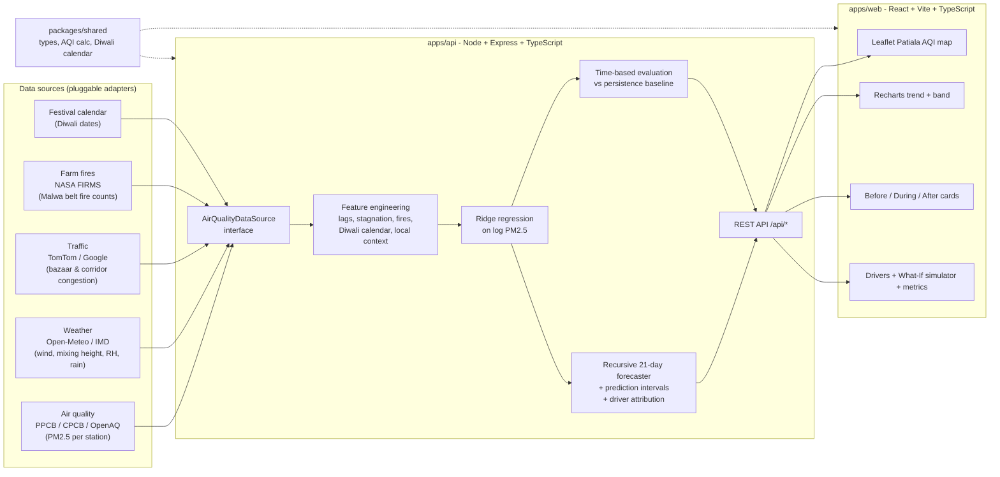

# 🪔 VaayuSense: Neighborhood-Level Diwali Air Quality Prediction for Patiala

> **root access hackathon — Problem statement:** *AI-Powered Neighborhood-Level Air Pollution Prediction System.*  
> Predict neighborhood-level air pollution **before, during and after Diwali** using historical air-quality data,
> weather conditions, traffic patterns and other environmental indicators.

**VaayuSense** forecasts daily **PM2.5 and Indian AQI for each Patiala neighborhood up to 21 days ahead**. It shows
a **before / during / after Diwali outlook** and explains **why** each day's air will deteriorate (fireworks,
stagnant boundary-layer air, Malwa paddy-stubble smoke, festive bazaar traffic, and meteorology).

  

---

## ✨ Features

| | |
|---|---|
| 🗺️ **Patiala neighborhood map** | Interactive watermark-free Leaflet map (Dark, Street & Satellite views) of 12 Patiala neighborhoods (*Adalat Bazar & Qila Mubarak, Tripuri Town, Focal Point Industrial, Leela Bhawan Market, ISBT & Rajpura Rd, Model Town, Urban Estate Phase-2, Thapar / Prem Nagar, Ranjit Nagar, Sanaur Road, Punjabi University, Baradari Gardens*), color-coded by the CPCB AQI scale with glowing plume halos, a day slider, and a *Jump to Diwali night* button. |
| 📈 **Forecast + uncertainty** | 30 days of observed AQI plus a 21-day recursive forecast with an 80% prediction band that widens with lead time. |
| 🪔 **Diwali phase outlook** | Average and peak AQI for **Before (−7…−1d)**, **During (Diwali + next day)** and **After (+2…+7d)** across Patiala wards, seamlessly blending observed and forecast days. |
| 🧠 **Explainable AI** | Each prediction is broken down into causal drivers such as *Diwali fireworks +180%*, *Low wind/mixing height +40%* and *Stubble burning smoke +35%*. |
| 🏆 **Hotspot ranking** | Ranks Patiala neighborhoods from worst to best for any selected day to help PPCB and Municipal Corporation Patiala plan targeted interventions (water sprinkling, bazaar traffic diversion, campus advisories). |
| 🧪 **What-if policy simulator** | Interactive sliders for **firecracker reduction %**, **traffic curbs**, **upwind Malwa stubble control**, and **artificial rain / smog-gun misting**, plotting the counterfactual 21-day AQI curve in real time. |
| ✅ **Honest evaluation** | A time-based holdout on the last full Diwali season compared against a persistence baseline, including a dedicated score for the critical Diwali ±3-day window. |
| 🩺 **Health advice** | CPCB category-specific respiratory and outdoor-activity guidance for every forecast. |

## 🏗️ Architecture



More detail on the model and data flow is in [docs/architecture.md](docs/architecture.md), and the 4-slide pitch deck + 3-minute demo flow is in [docs/pitch-deck.md](docs/pitch-deck.md).

## 🧠 How the model works

1. **Target:** next-day `log(PM2.5)` per Patiala neighborhood. Working in log space handles the heavy-tailed Diwali spikes and gives multiplicative, explainable effects.
2. **Features (22):**
   - **Persistence:** PM2.5 yesterday, two days ago and the 7-day mean.
   - **Meteorology:** wind speed, boundary-layer mixing height, humidity, rain and temperature over Patiala.
   - **Traffic:** a ward congestion index capturing weekday rhythms, the pre-Diwali shopping surge in markets like Adalat Bazar & Leela Bhawan, and the Diwali-night lull.
   - **Stubble burning:** upwind paddy-residue fire counts in the surrounding Patiala/Sangrur belt, plus fires × calm-wind interaction.
   - **Season:** day-of-year sine and cosine harmonics.
   - **Diwali calendar:** pre-festive week, eve, night, day after and +2 days.
   - **Neighborhood context, learned from history:** baseline pollution level and the **historical Diwali uplift** for that Patiala neighborhood, capturing hyper-local variations in firecracker density.
   - **Interactions:** Diwali night × local uplift and Diwali night × low wind.
3. **Algorithm:** L2-regularized ridge regression on standardised features, implemented from scratch in TypeScript with zero ML dependencies. It trains in under 150 ms and is 100% interpretable.
4. **Forecasting:** recursive multi-day forecasting. Each predicted day feeds the next day's lag features while weather and traffic come from forecasts. Prediction intervals are calibrated from holdout residuals and widen with lead time.
5. **Explainability:** contribution = coefficient × z-score. Contributions are aggregated into causal driver groups and reported as the % change in PM2.5 relative to average conditions.

## 🚀 Quick start

```bash
# Requires Node ≥ 20
npm install
npm run dev        # API → http://localhost:4000/api, dashboard → http://localhost:5173
```

Other scripts:

```bash
npm run build      # type-check & build shared + api + web
npm start          # serve API + built dashboard on http://localhost:4000
npm test           # unit + model sanity tests
npm run evaluate   # backtest every past Diwali season vs persistence
AIRSENSE_TODAY=2025-10-12 npm run dev   # replay any date (e.g. last year's Diwali)
```

## 🔌 REST API

| Method | Endpoint | Description |
|---|---|---|
| GET | `/api/meta` | Today, the upcoming Diwali date, the countdown and the current phase |
| GET | `/api/neighborhoods` | All 12 Patiala neighborhoods with their latest observation and today's forecast |
| GET | `/api/neighborhoods/:id/history?days=60` | Observed daily PM2.5/AQI, weather, traffic and fires |
| GET | `/api/neighborhoods/:id/outlook` | Before / during / after Diwali summary |
| GET | `/api/forecast?days=21` | 21-day forecasts for every Patiala neighborhood |
| GET | `/api/forecast/:id` | Forecast for one neighborhood, with causal drivers and confidence intervals |
| GET | `/api/simulate/:id?fireworks=60&traffic=35&stubble=40&rain=1` | Counterfactual 21-day forecast under policy interventions |
| GET | `/api/model` | Algorithm, holdout metrics and feature weights |

## 📁 Repository layout

```
.
├── apps/
│   ├── api/                 # Express API + ML pipeline
│   │   ├── src/data/        # AirQualityDataSource interface, Patiala synthetic simulator & neighborhoods
│   │   ├── src/model/       # features, ridge regression, training/evaluation, forecaster
│   │   ├── src/service.ts   # trains at startup, caches forecasts, Diwali outlook & policy simulator
│   │   └── test/            # node:test unit + model sanity tests
│   └── web/                 # React + Vite dashboard (Leaflet Patiala map, Recharts, What-If simulator)
├── packages/shared/         # shared types, CPCB AQI conversion, Diwali calendar
└── docs/                    # architecture.md & pitch-deck.md
```

## 📊 Data

> [!NOTE]
> The MVP runs offline on a **seeded synthetic simulation** of Patiala & the surrounding Malwa region (2022 to today). It models winter temperature inversions,
> wind and boundary-layer stagnation, monsoon/winter rain washout, bazaar and corridor traffic (weekday effects and the pre-Diwali shopping surge), Malwa paddy-stubble fire smoke, and
> neighborhood-specific Diwali fireworks spikes across Patiala's 12 zones. The model never sees the simulator's hidden parameters; it must learn them from historical observations.
> Real feeds plug in by implementing `AirQualityDataSource` (see `apps/api/src/data/source.ts`).

Planned real sources: **PPCB / CPCB CAAQMS & OpenAQ** (PM2.5), **Open-Meteo / IMD** (historical and forecast weather for Patiala `30.34°N, 76.39°E`, including planetary boundary-layer height),
**NASA FIRMS** (VIIRS/MODIS paddy-fire counts in Patiala/Sangrur), and **TomTom Traffic Index** (congestion).

## 👥 Team

_Add team members here._
