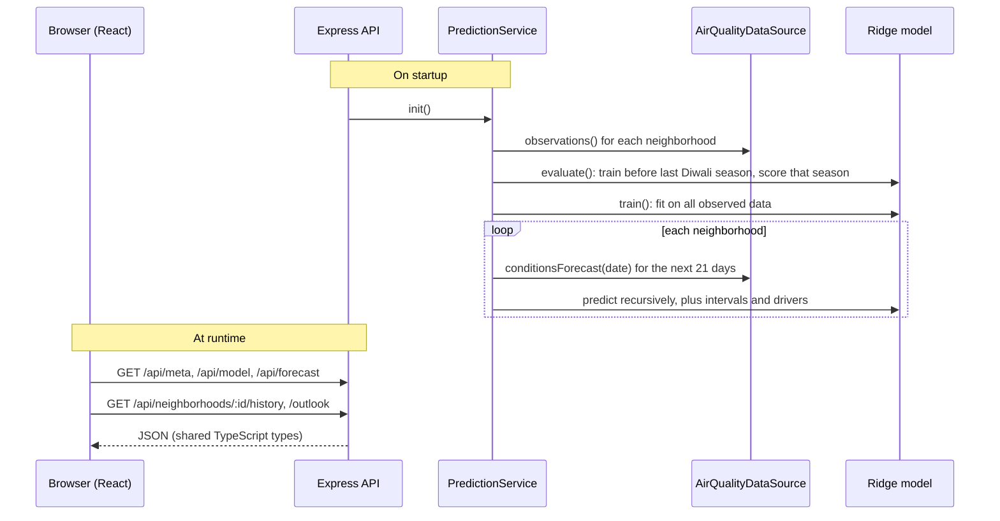
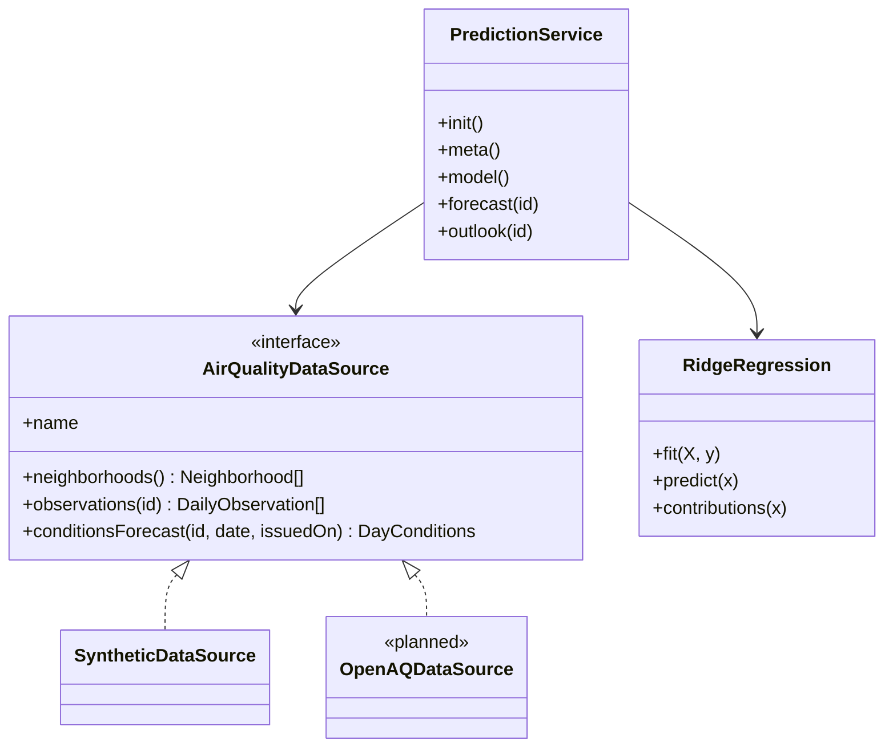

# Architecture

## Request / data flow

## Modules

## Model design decisions

| Decision | Why |
|---|---|
| Predict `log(PM2.5)` and convert to AQI afterwards | AQI is piecewise-linear and saturates at 500. PM2.5 is what physics and sensors produce, and the log handles Diwali spikes. |
| Linear model with engineered features | Trains in under 1 s and every prediction is explainable. That matters for public advisories and for judges. The feature pipeline can be reused by GBMs later. |
| Neighborhood target encoding (baseline, Diwali uplift) | Captures hyper-local behaviour such as cracker intensity without one-hot explosion, and generalises to new wards once they have history. |
| Recursive forecasting | Persistence is the strongest single signal. Recursion propagates the Diwali spike into the following days. |
| Time-based holdout on the last Diwali season | Random splits leak the future. We report a persistence baseline and a Diwali ±3-day window, which is where naive models fail. |

## Scaling path

- Data ingestion: cron jobs pull CPCB/OpenAQ data hourly into Postgres + TimescaleDB, and the data source reads from the DB.
- Model: retrain nightly. Serve the latest forecasts from cache (Redis) so the API stays stateless and horizontally scalable.
- Spatial: interpolate station forecasts to a ward-level grid (IDW or kriging) for full city coverage.
